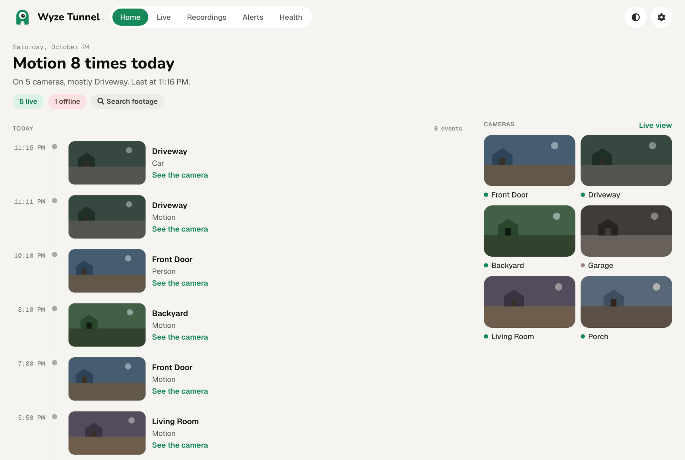
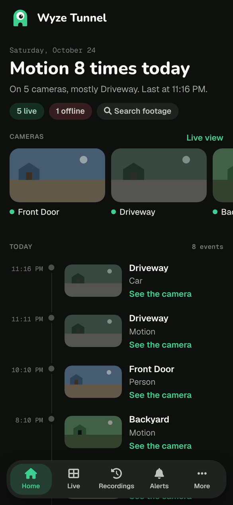
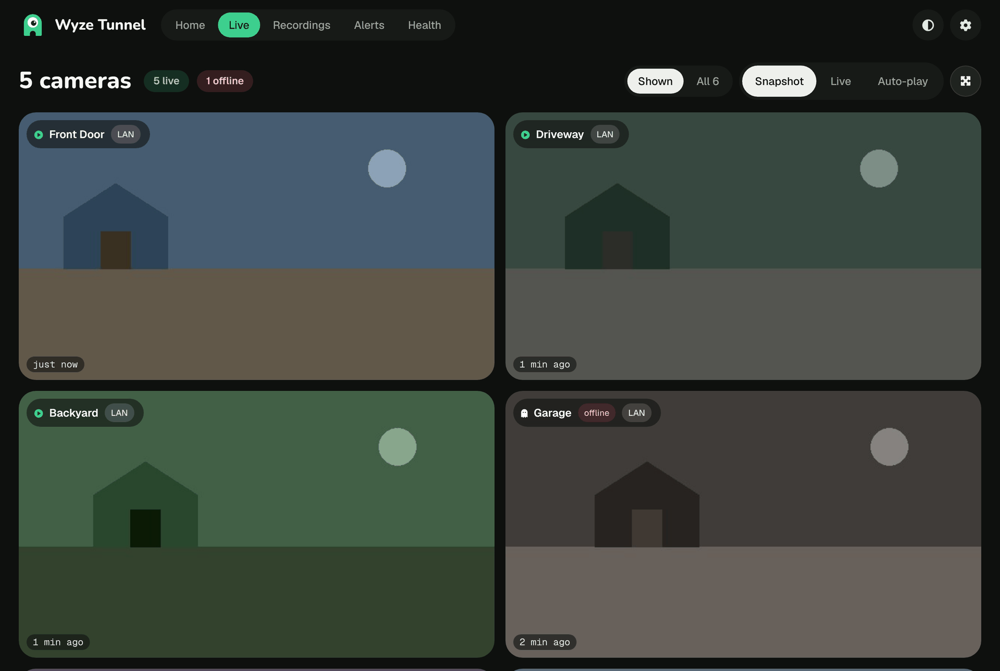
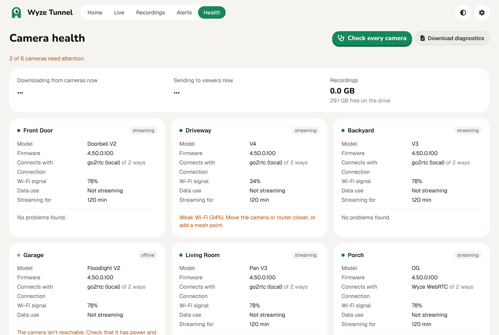

<p align="center"></p>

<h1 align="center">Wyze Tunnel</h1>

<p align="center">Watch, record and get alerts from your Wyze cameras on your own computer. No subscription, no Docker, nothing to forward on your router.</p>

<p align="center">
  <a href="https://github.com/itskiwi/Wyze-Tunnel/releases/latest"></a>
  <a href="https://github.com/itskiwi/Wyze-Tunnel/actions/workflows/ci.yml"></a>
</p>



<p align="center">&nbsp;&nbsp;</p>

<sub>Screenshots use made-up demo cameras.</sub>

## What you get

- **Home**: what happened today as a timeline, with a picture of each event and a one-tap clip. Doorbell rings get their own visitor log, and you can pin cameras on a floor plan.
- **Live**: every camera on one page, as still pictures, tap-to-play or auto-play. Picture-in-picture, full screen, save a photo, and pan/tilt, siren, lights and night vision for cameras that have them.
- **Recordings**: pick cameras to record and a size limit, and old clips clear themselves. Daily timelapse, shareable 24-hour clip links, and privacy masks for shared clips.
- **Search footage**: find when a person, car or animal showed up and jump to that moment. Runs on your computer (a stronger model is one click away on a PC), or uses Frigate if you have it. Includes a heatmap and activity zones.
- **Alerts**: phone notifications through the free [ntfy](https://ntfy.sh) app, or Discord, Slack and Telegram, with a snapshot. Home and Away modes, quiet hours and a morning summary.
- **Health**: one page that says what's wrong (offline, weak Wi-Fi, full SD card) with a fix-it button next to each problem, plus data use per camera. Cameras that keep failing restart themselves.
- **On your phone**: add it to your Home Screen for an app-like layout with a tab bar. Pair a phone by scanning a code, no password to type. Guest and family logins expire or stay as you choose.
- **Connect apps**: Apple Home (scan a QR code per camera), Home Assistant (one paste through HACS), Claude and other AI apps over MCP, phone shortcuts for Home and Away, and an API with per-app keys and signed webhooks. See [docs/apps-and-api.md](docs/apps-and-api.md).
- **Streams for everything else**: each camera is also an RTSP, HLS, WebRTC and RTMP stream for VLC, Frigate, Blue Iris and the rest.

Light and dark mode follow your system, or pick one with the button at the top.



## Install

### Windows 10 and 11 (recommended)

1. Download the `x64-setup.exe` installer from the [latest desktop release](https://github.com/itskiwi/Wyze-Tunnel/releases?q=desktop-v).
2. Open it. Windows may say it protects your PC because the app isn't signed yet: click **More info**, then **Run anyway**.
3. Click **Set up** in the window that opens, then sign in with your Wyze account.

Wyze Tunnel then lives in the tray. It starts with Windows, restarts itself if it stops, and updates itself; the tray menu also has **Check for updates**, the web page, and **Status and password**.

On Windows, cameras connect through [go2rtc](https://github.com/AlexxIT/go2rtc): over your home network on recent firmware, otherwise through Wyze's cloud. Camera controls work on your network, and the siren, lights and motion detection go through Wyze's cloud. Only cameras away from home or on old firmware need the Linux-only Wyze library. When you have one, the tray shows **Full camera support (WSL)…**, which asks permission once and may need a restart.

### Tunnel Box (Raspberry Pi or mini PC)

Turn a spare Raspberry Pi 4/5 or a 64-bit mini PC (like an Intel N100) into a box that only runs Wyze Tunnel:

1. Download the image from the [latest release](https://github.com/itskiwi/Wyze-Tunnel/releases/latest): `wyze-tunnel-box-pi.img.xz` for a Raspberry Pi, `wyze-tunnel-box-pc.img.xz` for a mini PC.
2. Write it to a microSD card (Pi) or a USB stick or SSD (PC) with [Raspberry Pi Imager](https://www.raspberrypi.com/software/) (**Choose OS**, then **Use Custom**) or [balenaEtcher](https://etcher.balena.io/).
3. Plug the box into your router with a network cable and turn it on.
4. After a few minutes, open **http://wyze-tunnel.local** on your phone or computer and sign in with your Wyze account. The setup page then shows the box's login. With a screen attached, the box shows a QR code to scan instead.

On Wi-Fi only? In Raspberry Pi Imager, click **Edit settings** before writing the card and enter your Wi-Fi there. The box updates itself every night. If `wyze-tunnel.local` doesn't open (some Android phones), use the box's address from your router's device list. A second box is `wyze-tunnel-2.local`.

### Linux

Debian, Ubuntu, Raspberry Pi OS, Fedora and Arch, one command:

```bash
curl -fsSL https://raw.githubusercontent.com/itskiwi/Wyze-Tunnel/main/native/install.sh | sudo bash
```

Then open `http://<this-machine>:5000` and sign in with your Wyze account. It starts on boot and updates itself once a day.

- Settings: `/etc/wyze-tunnel/wyze-tunnel.env` (`NAME=value`), then `wyze-tunnel restart`.
- Something wrong? `wyze-tunnel help` lists `status`, `restart`, `logs`, `update`, `repair` (reinstall, keeping settings) and `password`.
- It installs the latest [release](https://github.com/itskiwi/Wyze-Tunnel/releases) for your CPU (x86_64, arm64 or armv7). Put `WT_REF=main` (or a branch or tag) before `bash` to install that source instead.
- Turn off auto-update: `sudo systemctl disable --now wyze-tunnel-update.timer`.
- Uninstall: `sudo /opt/wyze-tunnel/uninstall.sh` (add `--purge` to also delete settings and sign-in data).

### Docker and the Home Assistant add-on

Still available for setups that already run containers:

```bash
docker run -p 5000:5000 -p 8554:8554 -p 8888:8888 ghcr.io/itskiwi/wyze-tunnel
```

Tags: `latest` (stable), `edge` (every merge to `main`) and `sha-abc1234` (one exact commit, for rolling back). Add `-hw` (VAAPI) or `-qsv` (Intel QuickSync) for the amd64 hardware-encoding image. A [compose sample](docker-compose.sample.yml) is in the repo.

For the Home Assistant add-on, add this repository to the add-on store and install **Wyze Tunnel**, **Wyze Tunnel (Edge)** or **Wyze Tunnel (hardware encoding)**:

[](https://my.home-assistant.io/redirect/supervisor_add_addon_repository/?repository_url=https%3A%2F%2Fgithub.com%2Fitskiwi%2FWyze-Tunnel)

### Mac

The Mac app and Terminal installer still exist, but they're on hold while Windows comes first, and they run the Wyze library in a small background VM. If you try it anyway, the installer is `curl -fsSL https://raw.githubusercontent.com/itskiwi/Wyze-Tunnel/main/mac/install.sh | bash`.

## Away from home

Nothing to open on your router. Install [Tailscale](https://tailscale.com/download) on the computer running Wyze Tunnel and on your phone, then open the gear menu, **Pair a phone**, and scan the **Anywhere** code. Your phone reaches the cameras over your private Tailscale network, wherever it is.

Please don't forward ports or put Wyze Tunnel in your router's DMZ.

## How it compares

Wyze Tunnel is for Wyze owners who want their cameras on their own network, with no subscription. Here's how it sits next to the other options, as of October 2026:

| | Wyze Tunnel | Wyze app + Cam Plus | docker-wyze-bridge | Frigate, Blue Iris, Agent DVR |
|---|---|---|---|---|
| Install | Windows app, Tunnel Box image, Linux one-liner or Docker | Phone app | Docker | Installer or Docker |
| Wyze cameras | Most models, including Cam OG over Wyze's cloud | All | TUTK models | Need a bridge like this one |
| Recording | On your computer, with a size limit | Wyze's cloud | Through MediaMTX settings | Yes, their main job |
| Smart detection | People and vehicles, or import from Frigate | Person, vehicle, pet, package | None | Strong (Frigate) to add-on based |
| Phone alerts | Home-screen web app | Native app | None | Native apps or web push |
| Cost | Free | $2.99 a month per camera | Free, not updated since 2024 | Free to about $70 |

Already on docker-wyze-bridge? Your settings and stream links carry over. See [Coming from docker-wyze-bridge](docs/coming-from-docker-wyze-bridge.md). Already recording with Frigate, Blue Iris or Agent DVR? **Connect apps → Recorders** in the web page gives you a ready camera setup for each.

## Supported cameras

| Camera | Model | Works |
|---|---|---|
| Wyze Cam v1 (HD only), v2, v3, v3 Pro, v4 | WYZEC1, WYZEC1-JZ, WYZE_CAKP2JFUS, HL_CAM3P, HL_CAM4 | Yes |
| Wyze Cam Pan, Pan v2, Pan v3, Pan Pro | WYZECP1_JEF, HL_PAN2, HL_PAN3, HL_PANP | Yes |
| Wyze Cam Floodlight, Floodlight v2 | WYZE_CAKP2JFUS, HL_CFL2 | Yes |
| Wyze Cam Outdoor, Outdoor v2 | WVOD1, HL_WCO2 | Yes |
| Wyze Video Doorbell, Doorbell v2 | WYZEDB3, HL_DB2 | Yes |
| Wyze Cam OG, OG Telephoto 3x | GW_GC1, GW_GC2 | Yes, through Wyze's cloud |
| Doorbell Pro, Doorbell Pro 2, Battery Cam Pro, Floodlight Pro | GW_BE1, AN_RDB1, AN_RSCW, LD_CFP | Yes, through Wyze's cloud (new, video only; tell us if yours doesn't connect) |

Some newer firmware blocks remote (P2P) connections. On your home network they still work.

### How Wyze Tunnel connects to each camera

Each camera has a list of ways to connect, and Wyze Tunnel moves to the next one after 5 failed tries in a row (`SOURCE_FALLBACK_AFTER`):

1. `tutk`: the Wyze SDK, the classic way. Works on your network and remotely, and supports every camera control. Linux, Tunnel Box, Docker and WSL only.
2. `lan`: [go2rtc](https://github.com/AlexxIT/go2rtc)'s built-in Wyze client. Works on your network, for cameras with DTLS firmware.
3. `webrtc`: Wyze's cloud WebRTC, through go2rtc. Works for cameras the Wyze app streams over WebRTC.

To pick the order yourself, set `SOURCE_<CAMERA_NAME>`, `SOURCE_<MODEL>` or `SOURCE`, like `SOURCE_FRONT_DOOR=lan,tutk` or `SOURCE_HL_CAM4=webrtc`. Use `auto` for the default. OG and the Pro cameras above try `webrtc` only. Battery cameras connect only while someone is watching, so they don't drain. Stream links stay the same whichever way a camera connects.

## Settings and stream links

Almost everything is set in the web page. For the rest, settings go in the settings file (`%LOCALAPPDATA%\Wyze Tunnel\wyze-tunnel.env` on Windows, `/etc/wyze-tunnel/wyze-tunnel.env` on Linux) or as Docker environment variables. Option names match docker-wyze-bridge, so its [wiki](https://github.com/mrlt8/docker-wyze-bridge/wiki) still covers audio, quality, filtering cameras, rotation, MQTT, snapshots and stream logins (`STREAM_AUTH`).

Ports: web page 5000, RTSP 8554, HLS 8888, WebRTC 8889, RTMP 1935. A camera named Front Door is `rtsp://<host>:8554/front-door`. Each camera's menu on the Live page has its links.

Reporting a bug? Use **Download diagnostics** on the Health page. It has versions, camera models and recent logs with emails, addresses, passwords and tokens removed. Then [open an issue](https://github.com/itskiwi/Wyze-Tunnel/issues).

## Credits

Wyze Tunnel started as a fork of [mrlt8/docker-wyze-bridge](https://github.com/mrlt8/docker-wyze-bridge), which builds on [kroo/wyzecam](https://github.com/kroo/wyzecam) and [@noelhibbard's script](https://gist.github.com/noelhibbard/03703f551298c6460f2fd0bfdbc328bd). Streaming uses [MediaMTX](https://github.com/bluenviron/mediamtx) and [go2rtc](https://github.com/AlexxIT/go2rtc). Full list in [THIRD_PARTY_NOTICES.md](THIRD_PARTY_NOTICES.md).

Other Wyze projects worth knowing: [wz_mini_hacks](https://github.com/gtxaspec/wz_mini_hacks) and [thingino](https://github.com/themactep/thingino-firmware) (custom firmware), [cryze](https://github.com/carTloyal123/cryze) and [cryze_v2](https://github.com/xerootg/cryze_v2) (Gwell cameras), and [wyze-sdk](https://github.com/shauntarves/wyze-sdk) (Wyze cloud API).

Not affiliated with Wyze Labs.
