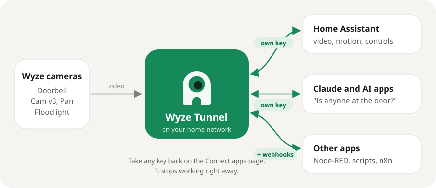
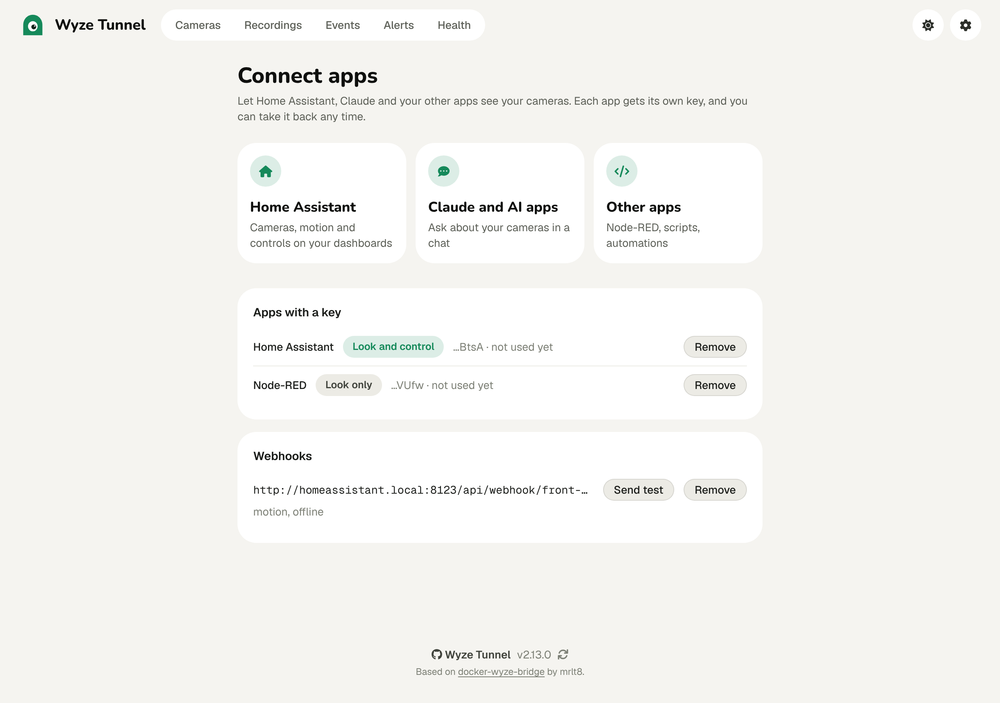
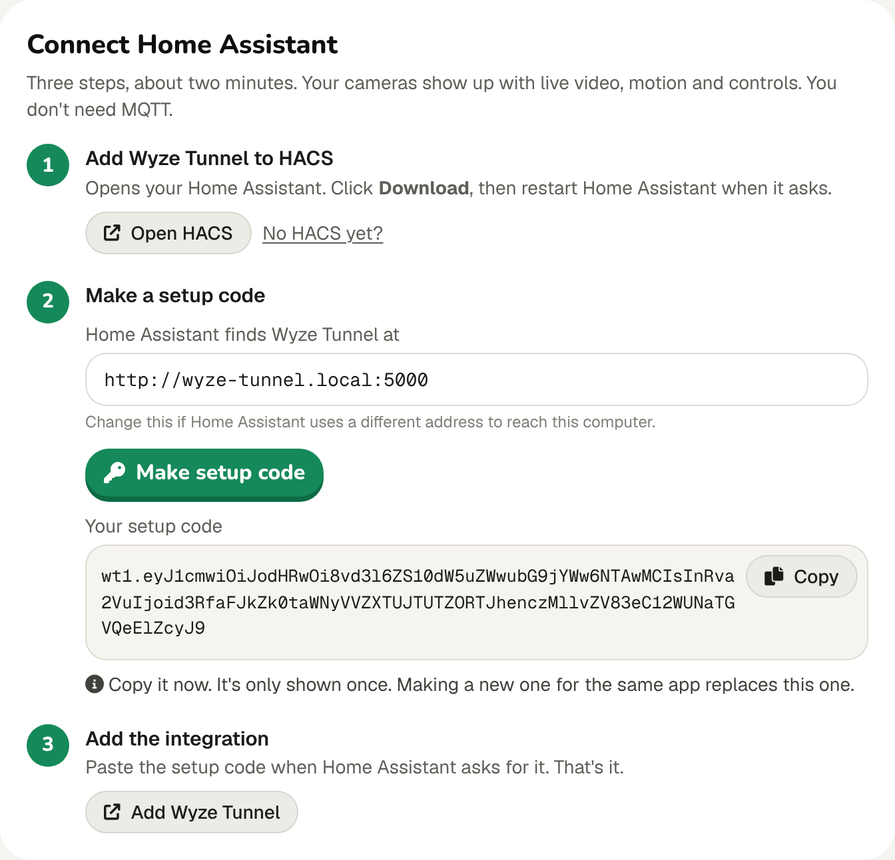
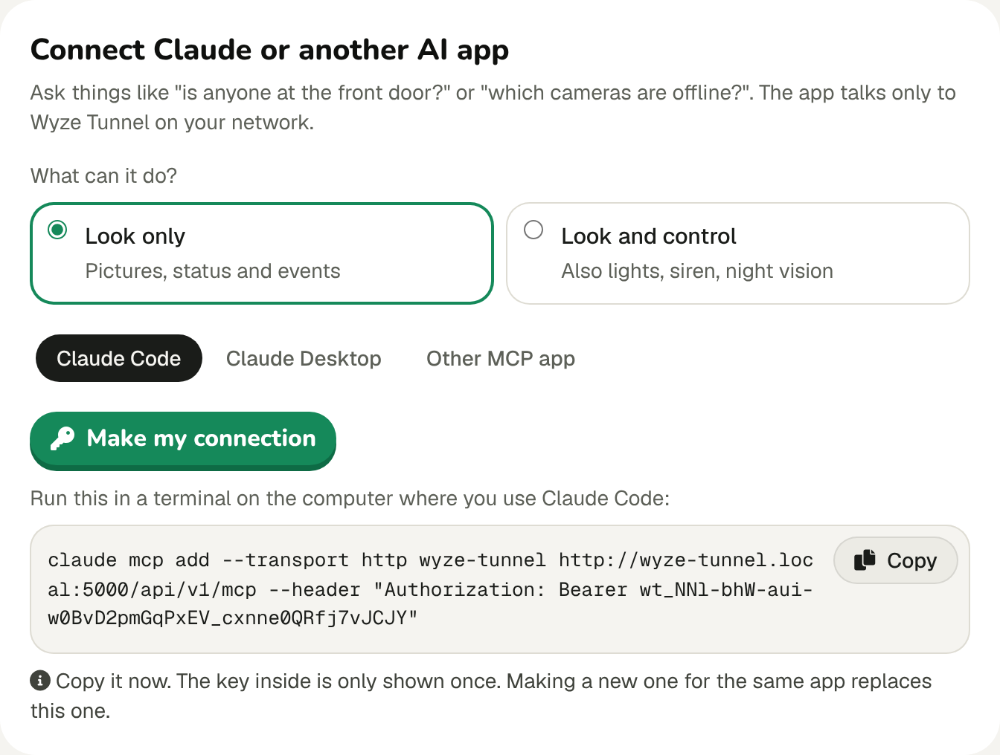
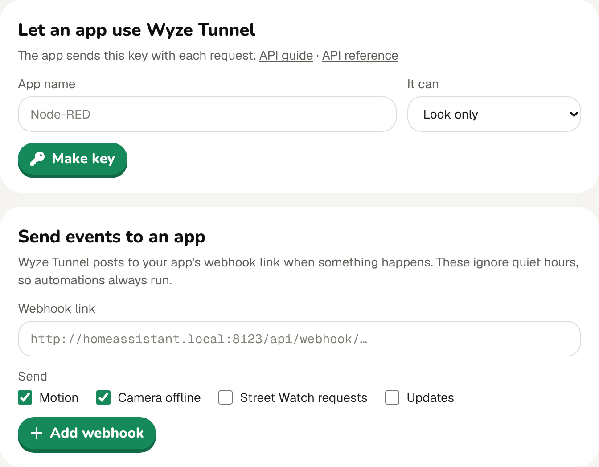
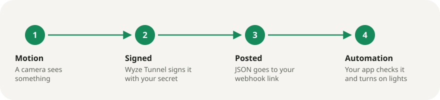

# Connect apps to Wyze Tunnel

Wyze Tunnel can share your cameras with Home Assistant, Claude and your other apps. Each app gets its own key. You choose
whether it can only look or can also control things, and you can take any key back with one click.



Everything starts on the **Connect apps** page: open Wyze Tunnel, click the gear in the top right, then **Connect apps**.



- [Home Assistant](#home-assistant)
- [Claude and other AI apps](#claude-and-other-ai-apps)
- [Node-RED, openHAB, Homey, Google and Alexa](#node-red-openhab-homey-google-and-alexa)
- [Other apps: the API](#the-api)
- [Other apps: webhooks](#webhooks)
- [How-tos](#how-tos)
- [Keeping it safe](#keeping-it-safe)
- [FAQ](#faq)

## Apple Home

Open **Connect apps**, pick **Apple Home** and turn on a camera. Then, on an iPhone on the same Wi-Fi, open the Home app, tap **+**, **Add Accessory**, and scan the code shown (or type the 8-digit number). Tap **Add Anyway** when it says the accessory isn't certified.

- Each camera is its own accessory with its own code. Turning a camera off forgets it, so turning it on again gives a new code.
- It uses go2rtc's HomeKit server. Apple devices pair on port 1984 (TCP) and get video on port 8443 (UDP), and find Wyze Tunnel with Bonjour (mDNS). Only the two pairing paths are opened on port 1984; the rest of go2rtc stays private.
- In Docker, Bonjour needs `network_mode: host`.
- Apple Home plays H.264 only, so cameras that stream H.265 won't show video.

## Home Assistant

You get a camera with live video for each Wyze camera, plus:

- **Activity**, an event that fires for motion, a doorbell press, or a person, vehicle, animal or package the detector saw.
  Use it to start automations: trigger on its state, and pick the kind in a condition on `event_type`.
- **Motion** and **Last motion**, **Online**, **Wi-Fi signal**, and **Problem**, which turns on when the Health page has
  something to fix for that camera (offline, weak Wi-Fi, full SD card).
- **Last event**, the picture from the newest event, ready for a phone notification or a dashboard.
- If your key can control things: switches for the stream, spotlights, floodlights and the siren, **Night vision** (auto,
  on, off), **Pan left/right** and **Tilt up/down** buttons for cameras that move, and **Alert mode** (Normal, Home, Away)
  on the Wyze Tunnel device, so presence automations can switch it. Cameras don't report their siren, light or night
  vision, so those show what Home Assistant last told them.

Recordings are in the **Media** panel under **Wyze Tunnel**, by camera, newest first. They play through Home Assistant, so
they work wherever Home Assistant does.

You don't need MQTT. If something isn't working, **Download diagnostics** on the integration gives a file with your
cameras' state and no passwords or keys.

**Before you start:** you need [HACS](https://hacs.xyz/docs/use/) in Home Assistant. It's the free add-on store most people
already have.

1. **Add Wyze Tunnel to HACS.** On the Connect apps page, click **Home Assistant**, then **Open HACS**. Your Home Assistant
   opens. Click **Download**, then restart Home Assistant when it asks.
2. **Make a setup code.** Check the address. It's where Home Assistant finds Wyze Tunnel, like `http://192.168.1.20:5000`.
   Then click **Make setup code**, and **Copy**.
3. **Add the integration.** Click **Add Wyze Tunnel**, paste the setup code, and click **Submit**.



Your cameras show up under **Settings, Devices & services, Wyze Tunnel**.

**Running Wyze Tunnel as a Home Assistant add-on?** The page opens inside Home Assistant, so it can't guess the address.
Type the add-on's address in step 2, like `http://homeassistant.local:5000`.

### Send any camera command

The integration adds an action called **Wyze Tunnel: Send command**. Use it in automations and scripts for anything without
its own switch:

```yaml
action: wyze_tunnel.send_command
target:
  entity_id: camera.front_door
data:
  command: night_vision
  value: "on"
```

See [the command list](#commands) for what you can send.

### Do something when a person is at the door

```yaml
alias: Porch light when someone's at the door
triggers:
  - trigger: state
    entity_id: event.front_door_activity
conditions:
  - condition: template
    value_template: "{{ trigger.to_state.attributes.event_type in ['person', 'doorbell'] }}"
actions:
  - action: light.turn_on
    target:
      entity_id: light.porch
```

### Get a phone notification with the picture

```yaml
alias: Person at the front door
triggers:
  - trigger: state
    entity_id: event.front_door_activity
conditions:
  - condition: template
    value_template: "{{ trigger.to_state.attributes.event_type == 'person' }}"
actions:
  - delay: 2  # give Wyze Tunnel a moment to save the picture
  - action: notify.mobile_app_your_phone
    data:
      message: Someone's at the front door
      data:
        image: /api/image_proxy/image.front_door_last_event
```

## Node-RED, openHAB, Homey, Google and Alexa

On the Connect apps page, click **Other apps**, then pick yours under **Use with your smart home**.

- **Node-RED.** Click **Make setup** and copy the flow. In Node-RED, open the menu, choose **Import**, paste it and click
  **Deploy**. It lists your cameras every 30 seconds, has a button that turns a spotlight on, and an **http in** node at
  `/wyze-tunnel` for events. Add your Node-RED address with `/wyze-tunnel` on the end (like
  `http://192.168.1.30:1880/wyze-tunnel`) under **Send events to an app**.
- **openHAB.** Install the **HTTP binding** and the **JSONPath transformation** from openHAB's add-on store. Click **Make
  setup**, save what you copy as `conf/things/wyze-tunnel.things`, then link the channels (motion, online, Wi-Fi, last
  event) to items. If you already send Wyze Tunnel to an MQTT broker with discovery on, openHAB's MQTT binding finds those
  cameras by itself too.
- **Homey.** Homey starts Flows from a webhook link. Make a Flow that starts with Logic's webhook card and name the event,
  like `wyze_motion`. Paste `https://YOUR-HOMEY-ID.connect.athom.com/api/manager/logic/webhook/wyze_motion` under **Send
  events to an app** and tick **Motion**. Make one per kind of event, like `wyze_person` with **Person seen**.
- **Google Home and Alexa** reach your cameras through Home Assistant. Set up [Home Assistant](#home-assistant) first,
  then turn on Home Assistant Cloud (or its Google Assistant or Alexa integration) and share the Wyze Tunnel cameras and
  motion sensors.
- **Anything else** (Hubitat, SmartThings, n8n, IFTTT): if it can make web requests, use [the API](#the-api); if it gives
  you a webhook link, paste it under **Send events to an app**.

## Claude and other AI apps

Ask questions like "is anyone at the front door?", "which cameras are offline?" or "turn on the backyard spotlight". The AI
app talks to Wyze Tunnel through MCP, the standard way AI apps connect to tools.

1. On the Connect apps page, click **Claude and AI apps**.
2. Pick **Look only** (pictures, status and events) or **Look and control** (also lights, siren and night vision).
3. Pick your app, click **Make my connection**, and **Copy**.



**Claude Code:** paste the command into a terminal and press Enter. Then start Claude Code and ask about your cameras.

**Claude Desktop:** open **Settings, Developer, Edit Config**. Paste what you copied into the file (if the file already has
an `"mcpServers"` section, add the `"wyze-tunnel"` part inside it). Save and restart Claude. This uses
[mcp-remote](https://www.npmjs.com/package/mcp-remote), so you need [Node.js](https://nodejs.org) installed.

**Other MCP apps:** use the address and header the page shows. The server speaks MCP over HTTP at `/api/v1/mcp`.

What the AI app can use:

| Tool | What it does | Key needed |
| --- | --- | --- |
| `list_cameras` | Every camera, and whether it's online, streaming or seeing motion | Look only |
| `get_snapshot` | A picture from one camera, right now | Look only |
| `recent_events` | Recent motion, newest first | Look only |
| `bridge_health` | Problems like offline cameras, weak Wi-Fi or a full SD card | Look only |
| `send_command` | Change a setting, like a light or night vision | Look and control |

The AI app only sees what Wyze Tunnel sends it. With a look-only key it can't change anything, and `send_command` doesn't
show up at all.

## The API

For your own scripts, Node-RED, n8n and anything else that can make web requests.

1. On the Connect apps page, click **Other apps**.
2. Type the app's name, pick what it can do, and click **Make key**.
3. Copy the key. The page also shows a ready-made test command.



Send the key in the `Authorization` header with every request:

```sh
curl -H "Authorization: Bearer wt_your_key" http://192.168.1.20:5000/api/v1/cameras
```

The full reference is in [openapi.json](../app/static/openapi.json). Your Wyze Tunnel also serves it at
`/static/openapi.json`, so you can load it into tools like Postman or Swagger UI.

| Request | What you get | Key needed |
| --- | --- | --- |
| `GET /api/v1/` | Checks the key: `{"name", "version", "scope"}` | Look only |
| `GET /api/v1/cameras` | Every camera | Look only |
| `GET /api/v1/cameras/{id}` | One camera | Look only |
| `GET /api/v1/cameras/{id}/snapshot` | A JPEG picture | Look only |
| `GET /api/v1/cameras/{id}/last-event.jpg` | The picture from the newest event | Look only |
| `GET /api/v1/cameras/{id}/recordings` | Recorded clips: `[{"start", "duration"}]` | Look only |
| `GET /api/v1/cameras/{id}/recordings/play?start=…&duration=…` | Part of a recording as MP4 | Look only |
| `GET /api/v1/events?limit=20` | Recent motion, newest first | Look only |
| `GET /api/v1/health` | `ok` or `degraded`, with each problem | Look only |
| `GET /api/v1/mode` | The alert mode: `schedule` (normal), `home` or `away` | Look only |
| `POST /api/v1/mode` | Switches it, for phone shortcuts and location automations. Body: `{"mode": "away"}` | Look and control |
| `POST /api/v1/cameras/{id}/commands/{command}` | Sends a command. Body: `{"value": "on"}` | Look and control |
| `POST /api/v1/mcp` | MCP server for AI apps | Look only (commands need control) |

A camera looks like this:

```json
{
  "id": "front-door",
  "name": "Front Door",
  "model": "Wyze Video Doorbell v2",
  "state": "connected",
  "online": true,
  "streaming": true,
  "enabled": true,
  "motion": false,
  "last_motion": 1792864000,
  "recording": false,
  "wifi": 68,
  "issues": [],
  "last_event": { "type": "person", "ts": 1792864000 },
  "features": { "doorbell": true, "pan_cam": false, "floodlight": false, "spotlight": false, "battery": false },
  "streams": {
    "rtsp": "rtsp://apps:…@192.168.1.20:8554/front-door",
    "hls": "http://192.168.1.20:8888/front-door/",
    "webrtc": null
  },
  "stream_login": { "username": "apps", "password": "…" },
  "snapshot": "api/v1/cameras/front-door/snapshot"
}
```

`motion` is true for 20 seconds after Wyze reports motion. The `rtsp` link already has a read-only login in it, so you can
open it in VLC or add it to a recorder like Frigate or Blue Iris. `wifi` is 0 to 100, or null when the camera hasn't said.
`issues` lists what the Health page would flag: `offline`, `repeated_failures`, `weak_wifi`, `sd_card_full`,
`using_relay`. `last_event.type` is `motion`, `doorbell`, or what the detector saw, like `person` or `car`.

### Commands

Send these to `POST /api/v1/cameras/{id}/commands/{command}`. Leave out `value` to read the current setting.

| Command | Values |
| --- | --- |
| `state` | `start`, `stop`, `enable`, `disable` |
| `night_vision` | `on`, `off`, `auto` |
| `irled`, `status_light`, `motion_detection`, `motion_tracking` | `on`, `off` |
| `spotlight`, `floodlight` | `on`, `off` |
| `fl_motion` (Floodlight v2), `wdr` (Doorbell v2) | `on`, `off` |
| `fl_brightness`, `fl_duration` (Floodlight v2) | `1`-`100` percent, seconds |
| `alarm` (siren) | `on`, `off` |
| `rotary_action` (pan cams) | `left`, `right`, `up`, `down` |
| `quality` | `hd180`, `sd60` and so on |
| `bitrate` | a number, like `120` |

Errors come back as `{"error": "…"}` with a status code: `401` for a wrong or removed key, `403` when a look-only key tries to
change something, and `404` for a camera that doesn't exist.

## Webhooks

Webhooks are the other direction: Wyze Tunnel tells your app when something happens.



1. On the Connect apps page, click **Other apps**.
2. Under **Send events to an app**, paste your app's webhook link and tick what to send: motion, person seen, camera offline, Street Watch
   requests or updates.
3. Click **Add webhook**. Copy the signing secret if your app will check signatures.
4. Click **Send test** next to the new webhook. You'll see your app's answer right there.

Webhooks ignore quiet hours and the Home/Away setting on the Alerts page. Those are for your phone; automations always run.

Each event is a `POST` with a JSON body:

```json
{
  "id": "4f1c9a2b7d3e5f60",
  "event": "motion",
  "camera": "front-door",
  "message": "Motion detected on Front Door at 18:02:11",
  "image_url": "https://…",
  "time": "2026-10-24T18:02:11+00:00",
  "version": "2.13.0"
}
```

`event` is `motion`, `person`, `offline`, `street`, `update` or `test`. `image_url` is a short-lived picture from Wyze, when there is one.

### Checking the signature

Every webhook has three headers:

- `X-Wyze-Tunnel-Event`: the event, like `motion`
- `X-Wyze-Tunnel-Timestamp`: when it was sent, in Unix seconds
- `X-Wyze-Tunnel-Signature`: `sha256=` and the HMAC-SHA256 of `<timestamp>.<body>`, using your signing secret

Checking it proves the event came from your Wyze Tunnel. Python:

```python
import hashlib, hmac, time

def is_from_wyze_tunnel(secret: str, headers: dict, body: bytes) -> bool:
    ts = headers["X-Wyze-Tunnel-Timestamp"]
    if abs(time.time() - int(ts)) > 300:  # older than 5 minutes: maybe a replay
        return False
    good = "sha256=" + hmac.new(secret.encode(), ts.encode() + b"." + body, hashlib.sha256).hexdigest()
    return hmac.compare_digest(good, headers["X-Wyze-Tunnel-Signature"])
```

Node.js:

```js
const crypto = require("crypto");

function isFromWyzeTunnel(secret, headers, rawBody) {
  const ts = headers["x-wyze-tunnel-timestamp"];
  if (Math.abs(Date.now() / 1000 - Number(ts)) > 300) return false;
  const good = "sha256=" + crypto.createHmac("sha256", secret).update(`${ts}.${rawBody}`).digest("hex");
  const got = headers["x-wyze-tunnel-signature"] || "";
  return got.length === good.length && crypto.timingSafeEqual(Buffer.from(good), Buffer.from(got));
}
```

Use the raw body exactly as it arrived, before any JSON parsing.

## How-tos

### Turn on the porch light when the doorbell sees motion (Home Assistant)

With the integration set up, make an automation:

```yaml
alias: Porch light on motion
triggers:
  - trigger: state
    entity_id: binary_sensor.front_door_motion
    to: "on"
actions:
  - action: light.turn_on
    target:
      entity_id: light.porch
```

### Get a webhook into Home Assistant without the integration

1. In Home Assistant, make an automation with a **Webhook** trigger. Copy its link, like
   `http://homeassistant.local:8123/api/webhook/front-door-motion`.
2. Paste that link into **Send events to an app** on the Connect apps page.
3. The event's fields are in `trigger.json`, like `trigger.json.camera`.

### Save a picture every hour (script)

```sh
curl -s -H "Authorization: Bearer wt_your_key" \
  -o "front-$(date +%H%M).jpg" http://192.168.1.20:5000/api/v1/cameras/front-door/snapshot
```

Run it from cron or Task Scheduler.

### Node-RED

The quickest way is the ready-made flow under [Use with your smart home](#node-red-openhab-homey-google-and-alexa). By hand:
use an **http request** node with the URL `http://192.168.1.20:5000/api/v1/cameras` and, under **Headers**, add
`Authorization` with `Bearer wt_your_key`. For events, add an **http in** node (method POST) and paste its address into
**Send events to an app**.

### Watch a camera in VLC

In VLC, choose **Media, Open Network Stream**, and paste the `rtsp` link from `GET /api/v1/cameras`.

## Keeping it safe

- **One key per app.** If you stop using an app or think its key leaked, click **Remove**. It stops working right away, and
  stream links handed out to apps get a new password at the same moment.
- **Look only by default.** Pick **Look and control** only for apps that need to change things.
- **Keys can't touch settings.** App keys only work with `/api/v1`. They can't open the web UI, change your login, make
  other keys, restart Wyze Tunnel or see your Wyze account.
- **Only you manage apps.** Guests and family logins can't open the Connect apps page.
- **Keys are shown once.** Wyze Tunnel stores a fingerprint (a SHA-256 hash), not the key, so nobody can read it back from
  the disk. The file with webhook secrets is readable only by Wyze Tunnel.
- **Webhooks only go where you point them.** They don't follow redirects, and they're signed so your app can check them.
- **Your network, your traffic.** Nothing goes through a cloud service. If you open Wyze Tunnel to the internet, put it
  behind HTTPS (for example with Tailscale or a reverse proxy) so keys aren't sent in the clear.

## FAQ

**Do I still need MQTT for Home Assistant?**
No. The integration talks to Wyze Tunnel directly. MQTT still works if you already use it.

**What's the difference between the add-on and the integration?**
The add-on runs Wyze Tunnel inside Home Assistant. The integration connects Home Assistant to a Wyze Tunnel, wherever it
runs. If you use the add-on, you can add the integration too.

**I lost my key or setup code.**
Make a new one with the same name. It replaces the old one, which stops working. Paste the new one into your app. In Home
Assistant, it asks for a new code by itself once the old one stops working.

**Home Assistant says it can't reach Wyze Tunnel.**
The address in the setup code has to work from the Home Assistant machine. Try opening it in a browser there. Use the IP
address (like `http://192.168.1.20:5000`) if the name doesn't work, then make a new setup code.

**The camera shows in Home Assistant but the video won't play.**
Home Assistant plays the RTSP stream on port 8554. Make sure that port isn't blocked between the two machines.

**Can Claude see my cameras all the time?**
No. Claude only asks Wyze Tunnel when you ask it something, and only through the tools listed above. Pictures are taken when
it calls `get_snapshot`.

**Does this work from outside my home?**
Apps need to reach Wyze Tunnel's address. At home that just works. From outside, use Tailscale or a VPN rather than opening
ports on your router.

**My webhook test fails.**
The page shows what went wrong: a timeout or connection error means your app's address can't be reached from Wyze Tunnel; a
number like `404` is your app's own answer. Check the link and that the app is running.

**How many apps can I connect?**
Up to 20 keys and 10 webhooks.

**Does the old API still work?**
Yes. `/api`, `/api/<camera>/<command>` and the `WB_API` key work as before. `/api/v1` is the one we document and keep
stable.
